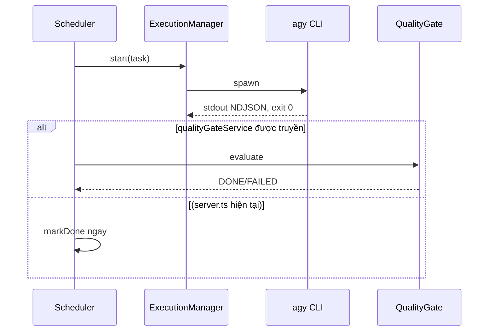

# 03 — System Flows

## Flow A: Import yêu cầu từ Excel
1. Mục đích: nạp feature/task từ Excel/CSV vào SQLite.
2. File: `routes/import.ts`, `services/import-service.ts`, `TaskRepository.createMany()`.
3. Luồng: `POST /import` (filePath) → đọc file → validate zod → preview → execute → `createMany`.
4. DB: `features`, `tasks`, `task_dependencies`.
5. Thành công: task tạo trạng thái ban đầu. Lỗi: file/schema sai trả lỗi validation.
6. Rủi ro: `filePath` tùy ý trên server (ISS-003); `createMany` bỏ `scope_files` (ISS-004).

## Flow B: Scheduler thực thi task
1. Mục đích: chạy task READY lần lượt (tối đa 1 process).
2. File: `task-scheduler.ts`, `run-service.ts`, `execution-manager.ts`, `state-service`.
3. Luồng: chọn task theo ưu tiên/dependency → quota → acquire lock → spawn `agy` → ghi events → exit.
4. DB: `tasks`, `runs`, `events`, `agent_locks`.
5. Thành công: chuyển VERIFYING rồi DONE qua gate. Lỗi: FAILED, requeue theo attempts.
6. Rủi ro: trong `server.ts` scheduler không có `qualityGateService` nên nhảy thẳng DONE khi exit 0 (ISS-001).

## Flow C: Quality Gate và Repair
1. Mục đích: chỉ DONE khi có bằng chứng.
2. File: `quality-gate-service.ts`, `quality-runner.ts`, `scope-diff-service.ts`, `security-check-service.ts`, `reviewer-service.ts`, `repair-loop-service.ts`.
3. Luồng: chạy lint/typecheck/test → scope diff → secret scan → review → nếu fail thì repair loop.
4. DB: `quality_command_records`, `review_findings`, `security_checks`, `repair_loops`, `quality_gate_evaluations`.
5. Rủi ro: repair spawn trực tiếp, bỏ lock/run record (ISS-009).

## Flow D: Recovery
`recovery-service.ts` tìm run RUNNING/PENDING, kiểm tra PID, requeue hoặc FAILED. Rủi ro: `findAll()` rồi filter trong bộ nhớ (ISS-008).

## Flow E: Dashboard
Dashboard fetch `http://127.0.0.1:3000/api/...` từ trình duyệt và nhận SSE log. Chưa xác minh chạy thật trên trình duyệt; thiếu CORS (ISS-002).
